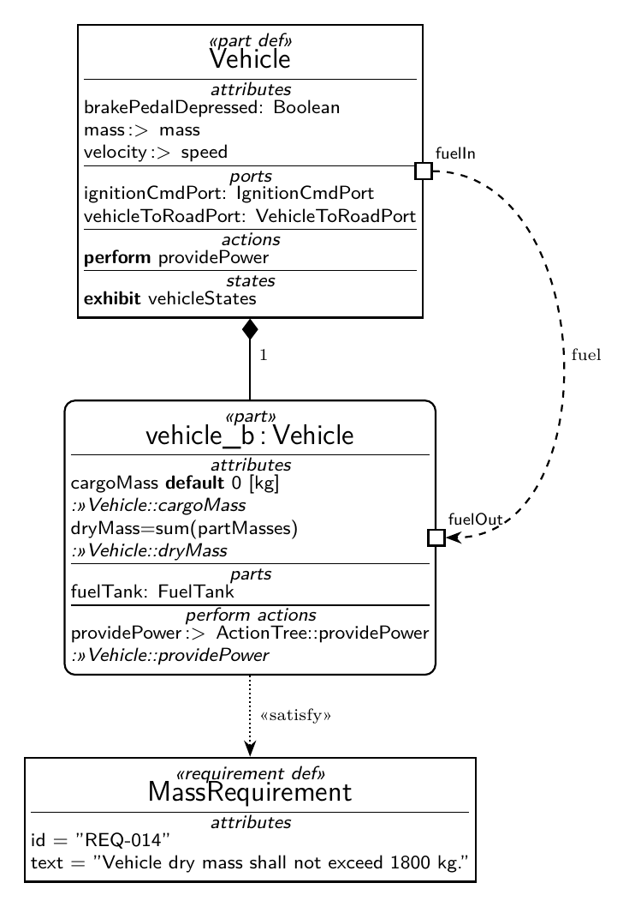
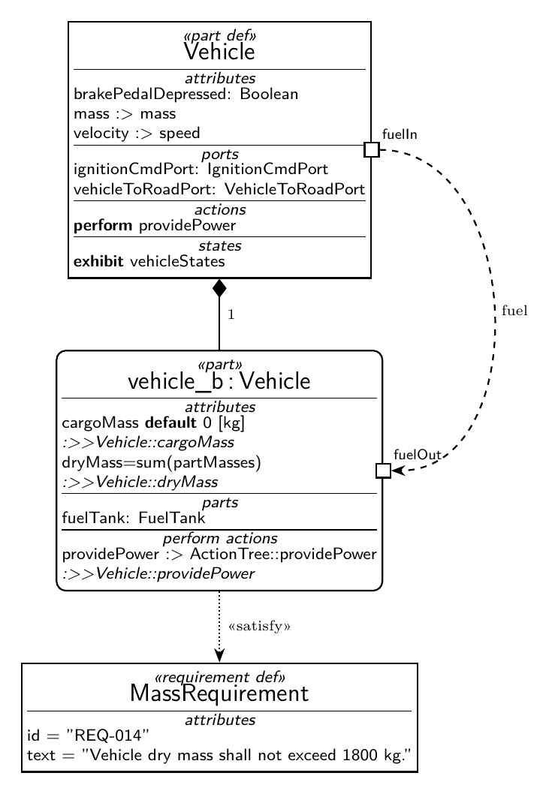
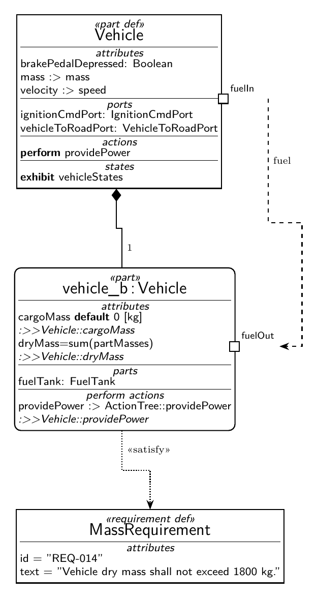
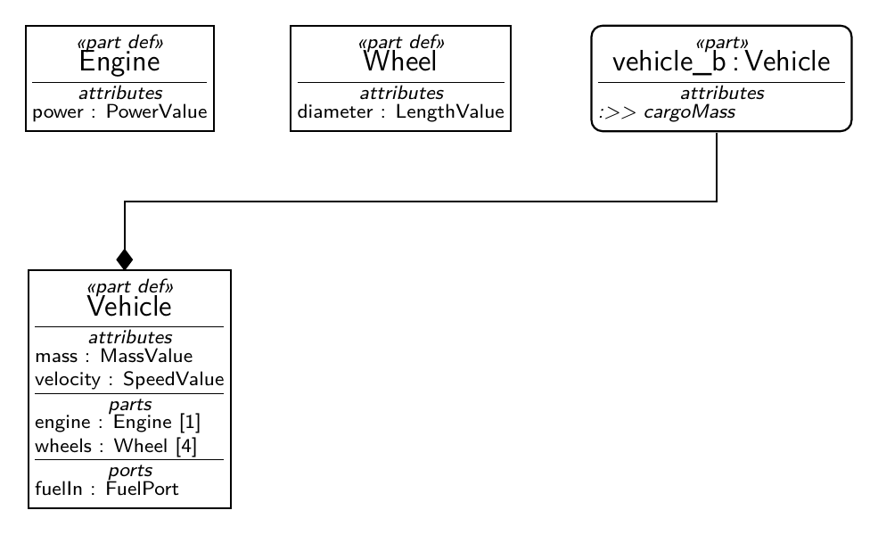

# tikz-sysml — SysML v2 notation in TikZ

Two things live here:

1. `sysml2tikz.sty` — a notation layer over plain TikZ. It encodes the
   definition/usage distinction the way the OMG SysML v2 reference figures draw
   it, and gives you compartments, ports, item flows and the relationship
   arrowheads without hand-drawing any of it.
2. `gen/` — the pipeline: `from_sysml.py` (sysmlpy → IR), `emit_tex.py` (IR →
   .tex), `layout_adapter.py` (TeX-measured sizes → diagramboxes' orthogonal
   router → absolute coordinates), `tools/verify.py` (golden diff, compile,
   geometry gates). See `PIPELINE.md`.

## Install

Two independent doors:

```bash
# LaTeX only, option A — put the .sty beside your document
#   (from CTAN once the package is accepted, or copy it out of the Python package)

# LaTeX only, option B — install once into your TeX user tree, then it is found
# from every directory, no copying per document:
pip install sysml2tikz
sysml2tikz install-sty          # -> $TEXMFHOME/tex/latex/sysml2tikz/sysml2tikz.sty
kpsewhich sysml2tikz.sty        # sanity check

# Python — the generator; the wheel carries the same .sty
pip install sysml2tikz
sysml2tikz emit model.json out.tex --copy-sty   # portable: .sty lands beside the output
tectonic out.tex                                # or pdflatex/lualatex/latexmk
```

With TeX Live, `install-sty` needs the picture and extra packages present:
`texlive-pictures` (pgf/TikZ) and `texlive-latex-extra` (`standalone.cls`,
`xstring`). `tectonic` needs none of that — it fetches what a document uses.

`--copy-sty` exists because tectonic resolves packages from its own bundle rather
than from `TEXINPUTS`, and a plain TeX Live only finds `sysml2tikz.sty` after CTAN
ships it. For a repo checkout the `gen/*.py` scripts are thin shims over
`src/sysml2tikz/*`, so the commands in `PIPELINE.md` keep working with no install.

Optional extras: `pip install "sysml2tikz[parse]"` (sysmlpy, for SysML text input)
and `pip install "sysml2tikz[layout]"` (diagramboxes, for routed layout).

## Build

```bash
tectonic demo.tex                 # hand-authored API demo
cd gen && python3 emit_tex.py model.json out.tex && tectonic out.tex
pdftoppm -r 190 -png -singlefile out.pdf out      # review raster
```

No system TeX required: `tectonic` fetches only what a document uses.

## Figures

All four are produced by this repo; the PNGs are 200 dpi rasters of the compiled PDFs.

Hand-authored macros — the definition/usage distinction in one picture
(`demo.tex`): square «part def», rounded «part», compartments, ports, composition,
«satisfy».



Same figure generated from a JSON notation IR (`gen/model.json` → `gen/emit_tex.py`) —
nothing typed by hand:



Laid out automatically: TeX-measured box sizes → diagramboxes' orthogonal router →
absolute coordinates and polyline edges (`gen/laid_out.tex`):



End to end from SysML v2 text — `examples/vehicle.sysml` parsed by sysmlpy, projected,
routed and rendered:



## Notation cards for vision models

[`docs/notation/`](docs/notation/index.md) is a description of every SysML v2
diagram kind written for a vision model rather than for a human reader: what the
frame header says, which shapes appear, which end of each edge carries the
diamond or the arrow, and how to tell two similar diagrams apart. Machine-readable
twin: [`notation.json`](docs/notation/notation.json); the markdown is rendered from
it by `tools/render_notation.py` and gated, so the two cannot drift.

## The distinction this package exists for

The corpus draws the two sides differently and the difference is semantic, not
decoration:

| | definition | usage |
|---|---|---|
| keyword | `«part def»` | `«part»` |
| box | square corners | rounded corners |
| header | name only | `name : Type` |
| compartment labels | bare noun (`attributes`, `ports`, `actions`, `states`) | verb + noun (`perform actions`, `exhibit states`) |
| rows | `max :> temperature` | `cargoMass default 0 [kg]`, `:>>Vehicle::cargoMass`, `dryMass=sum(partMasses)` |

Grounded in `fig-57-Part-Definition-for-Vehicle.svg` and
`fig-61-Part-Usage-for-vehicle_b.svg` under
`~/proj/third_party/SysML-v2-Release/doc/images/sysml/` — every other kind pair
(`attribute`, `port`, `item`, `requirement`, `action`, `state`, `calc`,
`constraint`, `allocation`, `interface`, `view`, `viewpoint`) has its own
`fig-NN-<Kind>-Definition-and-Usage.svg` in that directory and is the
acceptance criterion for extending the table.

## API

```tex
\sysmldefnode[at={(0,0)}]{veh}{part def}{Vehicle}{%
  \sysmlcomp{attributes}
  brakePedalDepressed: Boolean\\
  \sysmlcomp{actions}
  \kw{perform} providePower\\
}
\sysmlusagenode[below=of veh]{vehb}{part}{vehicle\_b}{Vehicle}{%
  \sysmlcomp{attributes}
  cargoMass \kw{default} 0 [kg]\\
  \redefines{:>>Vehicle::cargoMass}\\
}
\sysmlport{veh}{east}{fuelIn}{above right}
\draw[sysml composition] (vehb) -- node[right, font=\scriptsize, pos=.5]{1} (veh);
\draw[sysml satisfy]     (vehb) -- node[right, font=\scriptsize, pos=.5]{«satisfy»} (req);
\draw[sysml itemflow]    (veh-p-east) to[out=0,in=0,looseness=1.15] (vehb-p-east);
```

Edge styles: `sysml composition` (filled diamond), `sysml reference`,
`sysml itemflow`, `sysml satisfy`, `sysml gen` (hollow triangle).

## Licence

`sysml2tikz.sty` is **MPL-2.0 OR LPPL-1.3c** (dual, your choice — LPPL is the branch
CTAN/TeX Live can carry). The Python under `gen/` and `tools/` is **MPL-2.0**.
SPDX identifiers are in every file; full texts and the reasoning are in `LICENSES/`.
